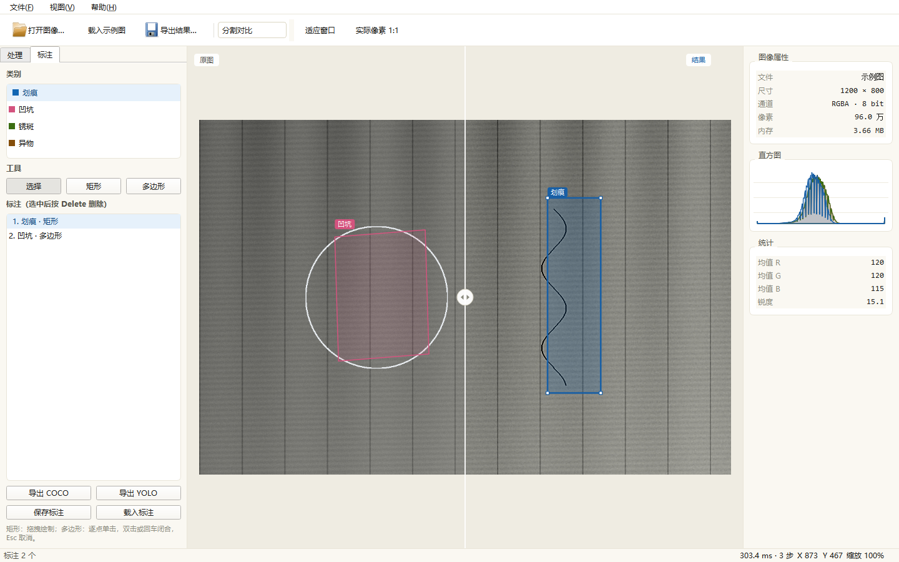
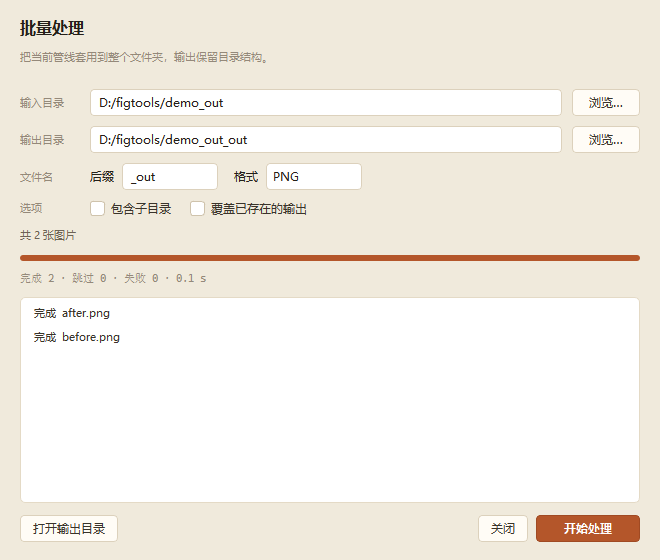
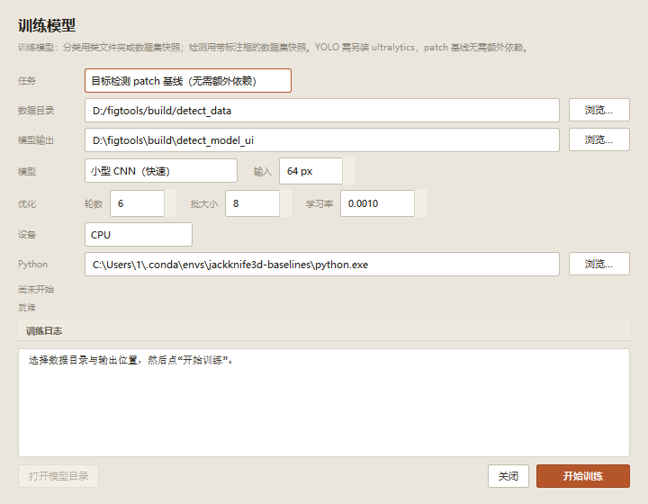
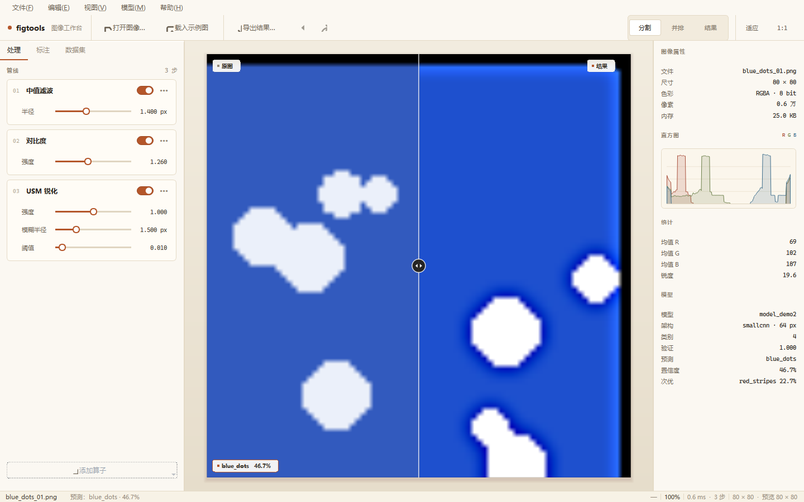
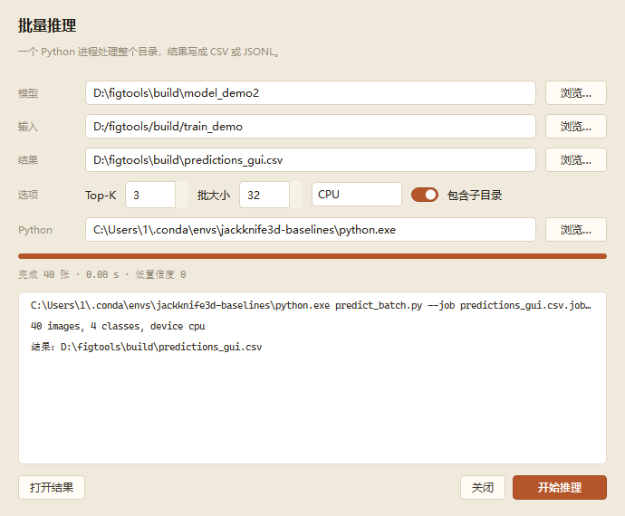
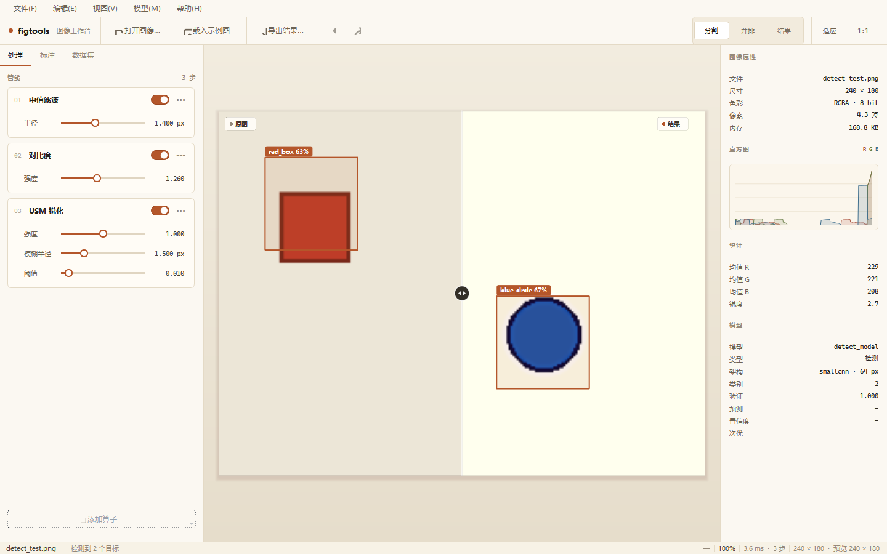
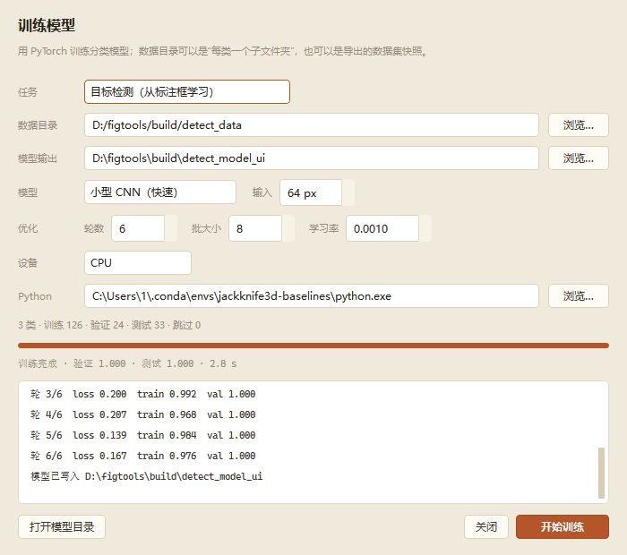

# figtools

**图像全流程工作台** —— 确定性图像内核 + Qt 桌面工作台 + 命令行工具，最终形态见 [设计基线](docs/DESIGN.md)。

[](https://github.com/liuhonghao/figtools/actions/workflows/ci.yml)
[](LICENSE)


---

## 状态

| 版本 | 内容 | 状态 |
|---|---|---|
| **v0.1** | 图像内核、算子库、PNG/BMP/PPM 编解码、Recipe 管线、CLI、单元测试 | ✅ 可用 |
| **v0.2** | Qt 6 桌面外壳：分割/并排/结果三视图、schema 驱动的处理链、直方图、导出 | ✅ 可用 |
| **v0.3** | 标注工作台：矩形/多边形、类别色、COCO/YOLO 导出、标注存读 | ✅ 可用 |
| **v0.4** | 数据集页：扫描、确定性三分划分、重复检测、快照导出 | ✅ 可用 |
| **v0.5** | 界面重做：暖纸色主题、自绘图标与控件、标定靶示例图、统一状态消息 | ✅ 可用 |
| **v0.6** | 批量处理：目录扫描、逐张套用管线、进度/日志/取消、跳过已存在 | ✅ 可用 |
| **v0.7** | 撤销/重做：配方快照历史、参数拖动合并、Ctrl+Z / Ctrl+Y | ✅ 可用 |
| **v0.8** | Python 训练与推理：PyTorch 分类训练、模型包、推理结果上画布 | ✅ 可用 |
| **v0.9** | 批量推理：单进程跑整目录、CSV/JSONL 结果、进度与取消 | ✅ 可用 |
| **v1.0** | 目标检测：从标注框裁片训练、滑窗 + NMS、检测框画回画布 | ✅ 可用 |
| v1.1 | ONNX 导出、实例分割、长驻 worker、检测批量推理 | 规划中 |
| v1.0 | 插件 ABI、批量任务中心、团队模式 | 规划中 |

















当前仓库是**可运行的纵向切片**，不是界面原型：`figtools demo` 会真的生成图像、跑处理链、写出结果并给出 PSNR/SSIM。

## 训练与推理（Python worker）

产品本体仍是 C++/Qt，不链接 PyTorch；训练与推理由独立的 Python 进程完成，崩溃不会带走界面。

```bash
# 在装有 torch/torchvision/Pillow 的环境里（例如 conda 的某个 env）
python python/train.py   --job job.json
python python/predict.py --model D:/models/run-1 --image D:/data/a.png --topk 3
python python/smoke_test.py
```

数据目录可以是「每类一个子文件夹」，也可以是**数据集页导出的快照**（按标注主类别取标签，无标注的图跳过）。
模型包是 `model.pt + model.json + metrics.json + job.json`，`model.json` 是 C++ 侧可读的元数据。

界面里：**模型 → 训练模型…**（`Ctrl+T`）选择解释器、架构、轮数、批大小、学习率和设备，训练时逐轮输出
loss / 训练精度 / 验证精度；**模型 → 载入模型…** 之后按 `Ctrl+R` 对当前图像推理，
结果同时出现在右栏和画布上的赤陶色标签里。解释器会自动在 `~/.conda/envs` 中找带 torch 的环境，
也可用 `FIGTOOLS_PYTHON` 指定。详见 [python/README.md](python/README.md)。

**模型 → 批量推理**：`Ctrl+Shift+R` 打开批量推理，用一个 Python 进程分类整个目录，
进度实时回传，结果写成 CSV（含 Top-K 标签与分数）或 JSONL，可按阈值把低置信度标为 `unknown`。
一次启动处理 40 张图只需 0.08 秒纯推理时间，避免每张图都付一次解释器启动成本。

**目标检测**（v1.0）：在「模型 → 训练模型…」把任务切到「目标检测」，用标注页画好的框/多边形训练一个 patch 检测器——每个标注裁成正样本，再补背景负样本；训练好后在「模型 → 检测当前图像」（`Ctrl+D`）对图片滑窗推理，NMS 合并后把赤陶色检测框画回画布。这样标注层的数据第一次真正变成了训练输入，而不再只用于派生整图类别。

## 它解决什么问题

图像处理工具的通病是「算得出，但复现不了」。同一个滤镜，今天和下周跑出不同结果；同一组参数，A 的机器和 B 的机器不一致。

figtools 把**可复现**当作硬约束：

```
产物 = f(输入像素哈希, 算子 id, 算子版本, 规范化参数, 随机种子)
```

这个组合就是 `cache key`。同样的输入和配方，必须产出同样的字节；测试里有一条用例专门守着它（`execution_is_deterministic`）。

## 快速开始

### 用 CMake（推荐）

```bash
git clone https://github.com/liuhonghao/figtools.git
cd figtools
cmake --preset dev
cmake --build --preset dev
ctest --preset dev
```

依赖只有 **CMake ≥ 3.24** 和 **zlib**（PNG 用）。

### 不装 CMake 直接编译

```bash
g++ -std=c++20 -O2 -Iinclude -Isrc \
    src/core/*.cpp src/io/*.cpp src/ops/*.cpp src/json/*.cpp src/annotate/*.cpp \
    src/dataset/*.cpp src/batch/*.cpp src/pipeline/*.cpp src/cli/*.cpp \
    -lz -o figtools
```

批量跑一个目录：

```bash
./figtools batch ./photos ./photos_out -r examples/recipes/surface_defect.json --format png
# [1/128] photos/IMG_0001.png
# total: 128  succeeded: 128  skipped: 0  failed: 0
```

### 桌面外壳（Qt 6）

```bash
# 需要 Qt 6.5+ 与配套的 MinGW 工具链（ABI 必须匹配）
cmake --preset dev -DFIGTOOLS_BUILD_GUI=ON -DCMAKE_PREFIX_PATH=/path/to/Qt/6.8.3/mingw_64
cmake --build --preset dev --target figtools_gui

# 没有 CMake 时用脚本（路径通过环境变量传入）
QT_ROOT=/path/to/Qt/6.8.3/mingw_64 CXX=/path/to/mingw/bin/g++.exe ./scripts/build_gui.sh
```

界面采用暖纸色系（米色底、墨色文字、赤陶色单一强调色），配色、字号、控件与图标集中在 `gui/theme.cpp`，不在各处硬编码。

界面能力：拖入图像即加载；左侧处理链由算子 schema 自动生成（增删、上下移、单步启停）；中间画布支持**分割对比**（拖分界线）、**并排对比**、**只看结果**，滚轮缩放、拖动平移；右侧显示属性、平滑直方图与统计；`Ctrl+S` 按原始分辨率导出。内置示例图是暖色标定靶（西门子星 / 12 级灰阶 / 色块 / 分辨率条），用于直观检验降噪、对比度与锐化。

**标注**页支持矩形拖拽与多边形逐点绘制（双击/回车闭合、Esc 取消）、类别着色、选中后 Delete 删除；标注可存为原生 JSON，也可导出 **COCO**（含 segmentation）或 **YOLO**（归一化 bbox）；还能写成图片旁边的 `.annotations.json`，供数据集页自动收纳。

**数据集**页选择目录后扫描图片与标注，按 70/15/15（可调、可分层、固定种子）划分，给出类别实例统计、重复内容检测与训练前检查，最后一键导出快照（`images/`、`annotations/`、`splits/*.txt`、`dataset.json`、`DATASET_CARD.md`）。

管线编辑支持**撤销/重做**（`Ctrl+Z` / `Ctrl+Y`）：添加、删除、排序、启停、参数调整都会入栈；一次连续拖动合并成一步，撤销后可重做，新操作会丢弃重做分支。

`Ctrl+B` 打开**批量处理**：选输入/输出目录、后缀与格式，把当前管线套用到整个文件夹；进度条、逐文件日志、随时取消，已存在的输出默认跳过（断电或中断后重跑只补缺失的）。

## 用法

```
figtools <command> [options]

  info <image>                          查看格式、尺寸与统计
  ops [--group <name>] [--json]         列出已注册算子
  apply -i <in> -o <out> -r <recipe>    按配方处理图片 [--trace]
  compare -a <before> -b <after>        PSNR / SSIM / MAE 报告 [--json]
  demo -o <dir> [--size WxH] [--seed N] 生成示例场景并跑通处理链
  version
```

### 示例：一条完整的处理链

```bash
$ figtools demo -o demo_out --size 1200x800 --seed 2026
demo      : 1200 x 800, seed 2026
before    : demo_out/before.png
after     : demo_out/after.png
recipe    : demo_out/recipe.json
steps     : 4 in 282.50 ms
  median          202.20 ms
  contrast          9.83 ms
  unsharp          35.73 ms
  gamma            34.14 ms
  PSNR             : 32.86 dB
  SSIM             : 0.8444
  MAE              : 4.55 / 255
  Changed pixels   : 97.7 %
  Identical        : no
cache key : a1b280f3b47d4e4f
```

`demo_out/recipe.json` 就是可复现的配方：

```json
{
  "version": 1,
  "seed": 2026,
  "steps": [
    { "op": "median", "enabled": true, "params": { "radius": 1 } },
    { "op": "contrast", "enabled": true, "params": { "factor": 1.12 } },
    { "op": "unsharp", "enabled": true, "params": { "amount": 0.75, "radius": 1.2, "threshold": 0.01 } },
    { "op": "gamma", "enabled": true, "params": { "gamma": 1.05 } }
  ]
}
```

换一张图，同一条配方：

```bash
$ figtools apply -i photo.png -o photo_fixed.png -r demo_out/recipe.json --trace
applied   : 4 step(s) in 281.03 ms
cache key : c9a1e0b1b7f5d3aa
output    : photo_fixed.png (1200 x 800)
```

### 已注册算子（19 个）

| 组 | 算子 |
|---|---|
| geometry | `resize` `crop` `rotate90` `flip` |
| color | `brightness` `contrast` `saturation` `gamma` `grayscale` `invert` `white_balance` `posterize` |
| filter | `box_blur` `gaussian_blur` `median` `unsharp` `sobel` `equalize` |
| analysis | `threshold` `otsu` `dilate` `erode` |

每个算子都带完整 schema（类型、范围、默认值、单位、说明），`figtools ops` 直接打印，CLI 与未来的 GUI 共用同一份定义。

## 设计要点

**1. 一种像素格式**
全链路统一 RGBA8 行主序。通道顺序、位深、alpha 语义的坑在 I/O 边界一次性解决，算子层不重复踩。

**2. 算子即 schema**
参数不存在于代码里，只存在于 `OperatorSpec`。CLI 帮助、GUI 控件、参数校验、缓存键规范化，全部由它派生——加一个算子只需要写一个 `.cpp`。

**3. 不跨模块抛异常**
所有可失败操作返回 `Result<T>`。失败路径在签名里，评审时看得见，插件边界也不会被异常穿透。

**4. 非破坏**
算子接收 `ImageView`（只读视图），返回新 `Image`。没有原地修改，撤销栈与对比视图才成立。

更多取舍见 [架构说明](docs/ARCHITECTURE.md) 与 [ADR](docs/adr/)。

## 目录

```
include/figtools/     公开头文件（core / io / ops / pipeline）
src/core/             图像、几何、色彩、哈希、指标、示例场景
src/io/               PNG(zlib) / BMP / PPM 编解码
src/ops/              算子实现与注册表
src/json/             零依赖 JSON 读写
src/annotate/         标注模型、COCO/YOLO 导出
src/dataset/          数据集扫描、确定性划分、快照导出
src/pipeline/         Recipe、执行器
src/cli/              命令行
gui/                  Qt 6 桌面外壳（可选构建）
python/               PyTorch 训练与推理 worker（NDJSON 事件协议）
tests/                79 项单元测试（零第三方依赖）
scripts/              无 CMake 时的构建脚本
docs/                 架构、设计基线、ADR、截图
examples/recipes/     配方样例
```

## 文档

- [设计基线](docs/DESIGN.md)：全栈技术体系与工作台方案（1700 行）
- [架构说明](docs/ARCHITECTURE.md)：分层、错误模型、确定性契约
- [贡献指南](CONTRIBUTING.md)：分支、提交规范、评审清单
- [变更记录](CHANGELOG.md)

## 贡献

提交前请跑：

```bash
clang-format -i $(git ls-files '*.cpp' '*.hpp')
cmake --build --preset dev && ctest --preset dev
```

约定：Conventional Commits、每个 PR 带测试、公共头文件改动用 ADR 说明。详见 [CONTRIBUTING.md](CONTRIBUTING.md)。

## 许可证

[MIT](LICENSE)
