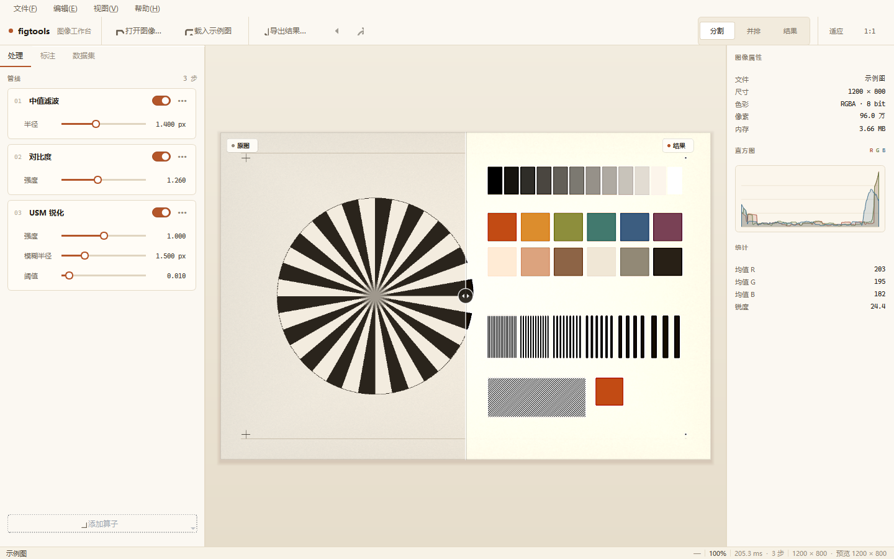
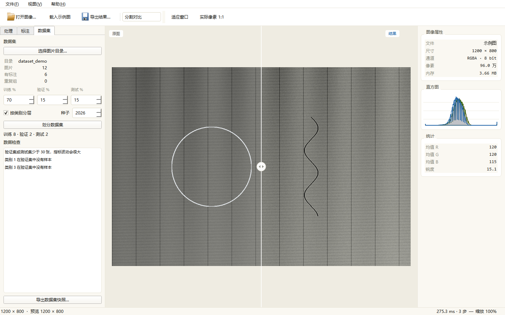

# figtools

**图像全流程工作台** —— 确定性图像处理内核 + 命令行工具，最终形态见 [设计基线](docs/DESIGN.md)。

[](https://github.com/liuhonghao/figtools/actions/workflows/ci.yml)
[](LICENSE)


---

## 状态

| 版本 | 内容 | 状态 |
|---|---|---|
| **v0.1** | 图像内核、算子库、PNG/BMP/PPM 编解码、Recipe 管线、CLI、40 项单元测试 | ✅ 可用 |
| **v0.2** | Qt 6 桌面外壳：分割/并排/结果三视图、schema 驱动的处理链、直方图、导出 | ✅ 可用 |
| **v0.3** | 标注工作台：矩形/多边形、类别色、COCO/YOLO 导出、标注存读 | ✅ 可用 |
| **v0.4** | 数据集页：扫描、确定性三分划分、重复检测、快照导出 | ✅ 可用 |
| v0.5 | Python 训练 worker、ONNX 交接、模型注册表 | 规划中 |
| v1.0 | 插件 ABI、批量任务中心、团队模式 | 规划中 |






当前仓库是**可运行的纵向切片**，不是界面原型：`figtools demo` 会真的生成图像、跑处理链、写出结果并给出 PSNR/SSIM。

## 它解决什么问题

图像处理工具的通病是「算得出，但复现不了」。同一个滤镜，今天和下周跑出不同结果；同一组参数，A 的机器和 B 的机器不一致。

figtools 把**可复现**当作硬约束：

```
产物 = f(输入像素哈希, 算子 id, 算子版本, 规范化参数, 随机种子)
```

这个组合就是 `cache key`。同样的输入和配方，必须产出同样的字节；测试里有一条用例专门守着它（`execution_is_deterministic`）。

## 快速开始

### 用 CMake（推荐）

```bash
git clone https://github.com/liuhonghao/figtools.git
cd figtools
cmake --preset dev
cmake --build --preset dev
ctest --preset dev
```

依赖只有 **CMake ≥ 3.24** 和 **zlib**（PNG 用）。

### 不装 CMake 直接编译

```bash
g++ -std=c++20 -O2 -Iinclude -Isrc \
    src/core/*.cpp src/io/*.cpp src/ops/*.cpp src/pipeline/*.cpp src/cli/*.cpp \
    -lz -o figtools
```

### 桌面外壳（Qt 6）

```bash
# 需要 Qt 6.5+ 与配套的 MinGW 工具链（ABI 必须匹配）
cmake --preset dev -DFIGTOOLS_BUILD_GUI=ON -DCMAKE_PREFIX_PATH=/path/to/Qt/6.8.3/mingw_64
cmake --build --preset dev --target figtools_gui

# 没有 CMake 时用脚本（路径通过环境变量传入）
QT_ROOT=/path/to/Qt/6.8.3/mingw_64 CXX=/path/to/mingw/bin/g++.exe ./scripts/build_gui.sh
```

界面能力：拖入图像即加载；左侧处理链由算子 schema 自动生成（增删、上下移、单步禁用）；中间画布支持**分割对比**（拖白色分界线）、**并排对比**、**只看结果**，滚轮缩放、拖动平移；右侧显示属性、直方图与统计；`Ctrl+S` 按原始分辨率导出。

**标注**页支持矩形拖拽与多边形逐点绘制（双击/回车闭合、Esc 取消）、类别着色、选中后 Delete 删除；标注可存为原生 JSON，也可导出 **COCO**（含 segmentation）或 **YOLO**（归一化 bbox）；还能写成图片旁边的 `.annotations.json`，供数据集页自动收纳。

**数据集**页选择目录后扫描图片与标注，按 70/15/15（可调、可分层、固定种子）划分，给出类别实例统计、重复内容检测与训练前检查，最后一键导出快照（`images/`、`annotations/`、`splits/*.txt`、`dataset.json`、`DATASET_CARD.md`）。

## 用法

```
figtools <command> [options]

  info <image>                          查看格式、尺寸与统计
  ops [--group <name>] [--json]         列出已注册算子
  apply -i <in> -o <out> -r <recipe>    按配方处理图片 [--trace]
  compare -a <before> -b <after>        PSNR / SSIM / MAE 报告 [--json]
  demo -o <dir> [--size WxH] [--seed N] 生成示例场景并跑通处理链
  version
```

### 示例：一条完整的处理链

```bash
$ figtools demo -o demo_out --size 1200x800 --seed 2026
demo      : 1200 x 800, seed 2026
before    : demo_out/before.png
after     : demo_out/after.png
recipe    : demo_out/recipe.json
steps     : 4 in 282.50 ms
  median          202.20 ms
  contrast          9.83 ms
  unsharp          35.73 ms
  gamma            34.14 ms
  PSNR             : 32.86 dB
  SSIM             : 0.8444
  MAE              : 4.55 / 255
  Changed pixels   : 97.7 %
  Identical        : no
cache key : a1b280f3b47d4e4f
```

`demo_out/recipe.json` 就是可复现的配方：

```json
{
  "version": 1,
  "seed": 2026,
  "steps": [
    { "op": "median", "enabled": true, "params": { "radius": 1 } },
    { "op": "contrast", "enabled": true, "params": { "factor": 1.12 } },
    { "op": "unsharp", "enabled": true, "params": { "amount": 0.75, "radius": 1.2, "threshold": 0.01 } },
    { "op": "gamma", "enabled": true, "params": { "gamma": 1.05 } }
  ]
}
```

换一张图，同一条配方：

```bash
$ figtools apply -i photo.png -o photo_fixed.png -r demo_out/recipe.json --trace
applied   : 4 step(s) in 281.03 ms
cache key : c9a1e0b1b7f5d3aa
output    : photo_fixed.png (1200 x 800)
```

### 已注册算子（19 个）

| 组 | 算子 |
|---|---|
| geometry | `resize` `crop` `rotate90` `flip` |
| color | `brightness` `contrast` `saturation` `gamma` `grayscale` `invert` `white_balance` `posterize` |
| filter | `box_blur` `gaussian_blur` `median` `unsharp` `sobel` `equalize` |
| analysis | `threshold` `otsu` `dilate` `erode` |

每个算子都带完整 schema（类型、范围、默认值、单位、说明），`figtools ops` 直接打印，CLI 与未来的 GUI 共用同一份定义。

## 设计要点

**1. 一种像素格式**
全链路统一 RGBA8 行主序。通道顺序、位深、alpha 语义的坑在 I/O 边界一次性解决，算子层不重复踩。

**2. 算子即 schema**
参数不存在于代码里，只存在于 `OperatorSpec`。CLI 帮助、GUI 控件、参数校验、缓存键规范化，全部由它派生——加一个算子只需要写一个 `.cpp`。

**3. 不跨模块抛异常**
所有可失败操作返回 `Result<T>`。失败路径在签名里，评审时看得见，插件边界也不会被异常穿透。

**4. 非破坏**
算子接收 `ImageView`（只读视图），返回新 `Image`。没有原地修改，撤销栈与对比视图才成立。

更多取舍见 [架构说明](docs/ARCHITECTURE.md) 与 [ADR](docs/adr/)。

## 目录

```
include/figtools/     公开头文件（core / io / ops / pipeline）
src/core/             图像、几何、色彩、哈希、指标、示例场景
src/io/               PNG(zlib) / BMP / PPM 编解码
src/ops/              算子实现与注册表
src/json/             零依赖 JSON 读写
src/annotate/         标注模型、COCO/YOLO 导出
src/dataset/          数据集扫描、确定性划分、快照导出
src/pipeline/         Recipe、执行器
src/cli/              命令行
gui/                  Qt 6 桌面外壳（可选构建）
tests/                61 项单元测试（零第三方依赖）
scripts/              无 CMake 时的构建脚本
docs/                 架构、设计基线、ADR、截图
examples/recipes/     配方样例
```

## 文档

- [设计基线](docs/DESIGN.md)：全栈技术体系与工作台方案（1700 行）
- [架构说明](docs/ARCHITECTURE.md)：分层、错误模型、确定性契约
- [贡献指南](CONTRIBUTING.md)：分支、提交规范、评审清单
- [变更记录](CHANGELOG.md)

## 贡献

提交前请跑：

```bash
clang-format -i $(git ls-files '*.cpp' '*.hpp')
cmake --build --preset dev && ctest --preset dev
```

约定：Conventional Commits、每个 PR 带测试、公共头文件改动用 ADR 说明。详见 [CONTRIBUTING.md](CONTRIBUTING.md)。

## 许可证

[MIT](LICENSE)
